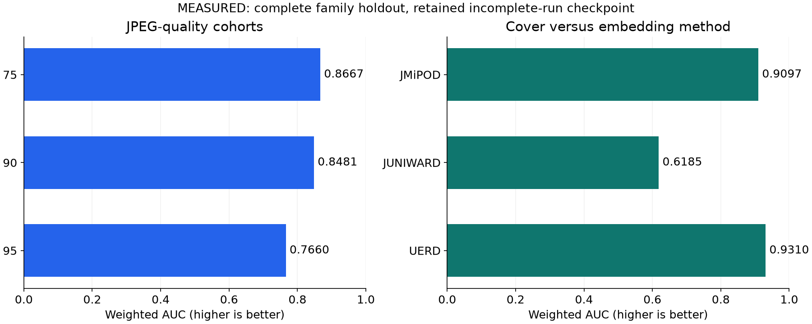

# ALASKA2: My Image Steganalysis Solution

My solution to the [Kaggle ALASKA2 competition](https://www.kaggle.com/competitions/alaska2-image-steganalysis), by **Chia-Ta Tsai**. Steganography changes an image to carry a hidden message while leaving its visible subject intact. The [ALASKA2 challenge](https://www.kaggle.com/competitions/alaska2-image-steganalysis) asks for a probability that a JPEG contains embedded data. My historical solution combines EfficientNet and SE-ResNeXt predictions with augmentation and stacking; the maintained workflow provides a reloadable EfficientNet baseline and sample-ordered predictions.

<!-- portfolio-results:start -->
## Results

**Leaderboard scores — weighted AUC ↑.**

| Model / submission | Public LB | Private LB | Public Top % |
|---|---:|---:|---:|
| Historical LightGBM stacker (2020-07-20) | 0.932 | 0.916 | **7.31%** |
| Historical TTA/LightGBM stacker (2020-07-18) | 0.928 | 0.917 | **10.96%** |
| Historical rank-averaged ensemble (2020-07-20) | 0.930 | 0.916 | **9.04%** |
| Maintained EfficientNet-B0 (single holdout) | Not submitted | Not submitted | Not applicable |

Public Top % uses the **2026-11-10 public leaderboard snapshot** (score-equivalent comparison, not an awarded final rank). [Detailed results](docs/results.md) · [Reference ranks, ties and calculation](docs/leaderboard-context.json).

Private Top % is unavailable without a matched private leaderboard; OOF/holdout results have no leaderboard percentile.
<!-- portfolio-results:end -->

## Why the probability of any embedding method matters

A file can contain a message from JMiPOD, JUNIWARD or UERD. The target combines those possibilities, so the solution uses `1 − P(Cover)` from its four-class model.

**MEASURED controlled comparison:** on the same saved checkpoint and complete family holdout, that readout reaches **0.83540 weighted AUC**. Using only the largest stego-class probability reaches **0.76748**, a change of **−0.06792**. The checkpoint, JPEG processing, rows and labels are fixed; the ranking actually changes. The loss appears in every recorded quality and embedding-method comparison. Retain the union-probability readout for this model. [Comparison, variation and remaining question](docs/modeling-study.md).

## Which images remain difficult?

**MEASURED:** JUNIWARD accounts for **2,179 of the 2,250 hardest stego predictions** under the fixed confidence-error diagnostic. Its Cover-versus-method weighted AUC is **0.61846**, compared with **0.90974** for JMiPOD and **0.93095** for UERD. Combining class probabilities helps the overall ranking and leaves a substantial method-specific weakness.

The quality-95 cohort has the weakest weighted AUC (**0.76598**), yet is underrepresented among the most extreme confidence errors. Ranking separation and confidence failures identify different problems. Quality cohorts also contain different source images, so these observations do not prove that compression causes the gap. [Hard-case rule, competing explanations and next experiment](docs/error-analysis.md).

## Keep the source image out of its own validation set

Cover and its embedded variants share image content. The original solution grouped source images before expanding variants; the maintained pipeline preserves that boundary and also checks byte identity across roles. **MEASURED:** the retained holdout has no source families or byte-identical groups crossing the fit/validation boundary. A diagnostic file split exposes siblings of **59,460 of 60,000** validation files to fitting; no accuracy gain from that diagnostic is claimed. [Evaluation protocol and limits](docs/results.md).

## From a JPEG to a prediction

The predictor decodes the native JPEG, retains its image dimensions, applies the recorded normalization and produces four class probabilities. Its application output is the probability of any embedded message. The same class order, preprocessing and checkpoint travel with prediction/export. The historical stacking records belong to their own submissions; the retained baseline does not inherit their leaderboard scores.

The maintained baseline is a **four-completed-epoch fallback from a declared five-epoch run**, evaluated on a complete single family holdout. Independent reload reconstructs its full holdout and test predictions. Its **0.83540 holdout weighted AUC** has no leaderboard percentile and cannot be compared directly with a scored competition submission. [Results, saved-model interface and limitations](docs/results.md) · [Prediction contract](docs/serving.md).

## Reproduce the result

Start with the [executed walkthrough](notebooks/01-method-and-rerun.ipynb) for the problem, results and modeling decisions. The [runbook](docs/reproduction.md) contains local, Docker/Jupyter/dev-container and authorized competition-input commands. The [offline Kaggle path](docs/kaggle.md) records its actual hosted-execution status. Public CPU fixtures test contracts and remain explicitly labeled.

The [problem/value discussion](docs/problem-and-value.md) separates detection quality from a prospective analyst workflow. [Evidence and requirements](docs/requirements-audit.md) retain the completed checks and open production work. Code is in `src/alaska2/`; original source and attribution remain in [legacy/](legacy/README.md).

## License

Source code retains the [Apache License 2.0](LICENSE). Competition data follows its own terms.
